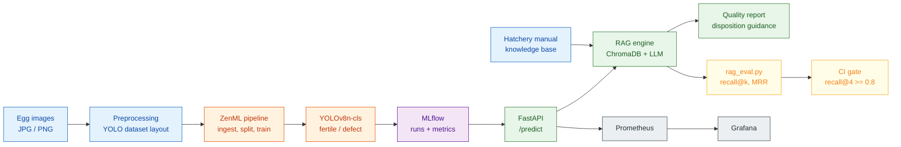
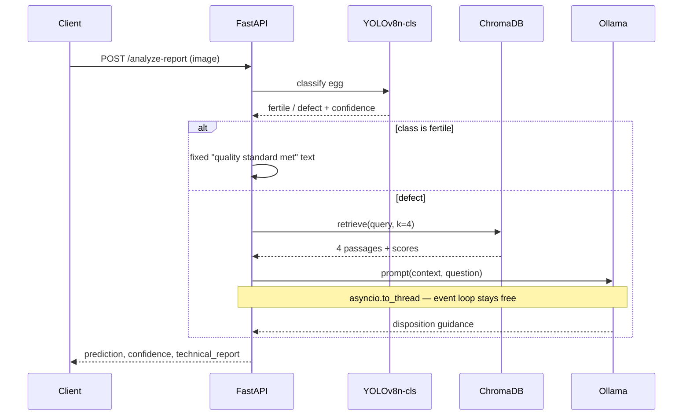

# OvoScan: CV Pipeline with ZenML


**OvoScan** is a production-shaped computer vision pipeline for automated visual inspection in manufacturing. It leverages **ZenML** for reproducible ML pipelines, **YOLOv8 classification** (97.2% top-1 accuracy) for defect grading, and **RAG via Ollama** for quality assessment reports. The platform supports both Docker Compose for local development and Kubernetes for production deployment.

---

**At a glance** — Top-1 **97.2%** · 172 unit tests · 14 CI jobs · YOLOv8n-cls + ZenML + ChromaDB RAG + drift monitoring

### What it does

- **Computer Vision:** YOLOv8n-cls classification model (97.2% top-1 accuracy) for egg quality grading (classes: `fertile`, `infertile`).
- **ZenML Pipelines:** Reproducible, versioned ML pipelines with experiment tracking.
- **GenAI Quality Reports:** ChromaDB retrieval over a quality manual, then a local LLM via Ollama writes the report (with template fallback).
- **Multi-page Dashboard:** Plotly Dash for professional inspection visualization.
- **DVC Integration:** Data version control for ML artifacts and datasets.
- **Kubernetes Ready:** Full K8s manifests and Helm charts for scalable deployment.
- **CI/CD Pipeline:** GitHub Actions for automated testing and deployment.
- **GPU Support:** Optimized for NVIDIA GPU acceleration in K8s.

### Architecture


The RAG call takes seconds on CPU. It runs in a worker thread so it cannot stall
the event loop — before that fix, a health check issued during generation waited
1.8 seconds.



### Verified results

Reproduced locally on an NVIDIA RTX 3050 Ti (4 GB).

| Metric | Value |
|--------|-------|
| Dataset | `egg_dataset/` (YOLOv8 classification layout: `train/`, `valid/`, `test/`) |
| Labelled images | 139 train (72 fertile / 67 infertile) |
| Classes | `fertile`, `infertile` (from `egg_dataset/data.yaml`) |
| Base model | YOLOv8n-cls |
| **Top-1 accuracy** | **97.2%** (`accuracy_top1 = 0.97193` in `ovoscan_train_runs/experiment_1/results.csv`) |
| Pipeline | ZenML (ingest → validate → train → evaluate → register) |
97.2% top-1 on 139 images has a wide confidence interval — roughly ±4 percentage
points — so it should not be claimed to generalise without a larger held-out
set. The task is also binary with visually distinct classes under candling, so a
high number is expected. The interesting engineering here is the pipeline and
the RAG agent, not the accuracy.

The 97.2% figure is read directly from the training run's `results.csv`. The
served checkpoint is the one produced by that run.

### RAG, measured

The quality assistant retrieves from a ChromaDB index over the hatchery manual,
then a local LLM answers. Retrieval quality is scored, not assumed:

| Metric | Value |
|---|---|
| `recall@4` | **0.900** (10 cases) |
| MRR | 0.783 |
| `hit@1` | 0.700 |

CI gates on `recall@4 >= 0.8`. **The one failure is real:** the Section 5
disposition table ranks 7th of 11 for its own question because the chunk also
carries the Section 6 heading. Documented rather than hidden by raising k.
Methodology: [docs/OPERATIONS.md](./docs/OPERATIONS.md).

### API

All endpoints except `/` and `/metrics` require `X-API-Key`.

| Method | Path | Limit | Purpose |
|--------|------|-------|---------|
| `GET` | `/` | none | Health: `model_loaded`, `rag_available`, `device` |
| `POST` | `/predict` | 60/min | Egg image in, fertile/defect + confidence out |
| `POST` | `/analyze-report` | 30/min | Classification + disposition guidance (off the event loop) |
| `GET` | `/drift` | 30/min | Drift state for classification inputs |
| `GET` | `/monitoring` | 30/min | Prediction counts, confidence distribution, latency |
| `POST` | `/admin/reload-model` | 5/min | Reload without a restart |
| `GET` | `/metrics` | none | Prometheus exposition |


### Quickstart

```bash
uv sync --extra dev
uv run python src/run_training.py              # ZenML: ingest → split → train
uv run uvicorn src.app:app --port 8003
curl -X POST http://localhost:8003/predict \
     -H "X-API-Key: demo-secret-key" -F "file=@egg.jpg"
```

Dataset setup, ZenML steps and troubleshooting: **[docs/OPERATIONS.md](./docs/OPERATIONS.md)**.

### Stack

| Service | Port | | Service | Port |
|---|---|---|---|---|
| FastAPI | 8003 | | Prometheus | 9093 |
| Streamlit UI | 8504 | | Grafana | 3000 |
| MLflow | 5000 | | MinIO | 9006 |
| TLS proxy | 8446 | | ZenML | 8080 |


Run this project alone with `./run_stack.sh` (API, MLflow, MinIO, Prometheus, Grafana). Dashboard: `streamlit run src/dashboard.py` (port 8504). Airflow and the Postgres feature store run through `docker compose`. The four-project orchestrator used during development is kept in the author's workspace and is not part of this repository.

### Security

| Control | Implementation |
|---|---|
| Auth | `X-API-Key` via `secrets.compare_digest` (constant-time) |
| TLS | nginx reverse proxy, TLSv1.2/1.3 |
| Upload limits | `Content-Length` rejected before the body is read |
| Rate limits | Per-endpoint, 429 on breach |

**Not in place:** RBAC, a secret manager, multi-node HA, a soak test. The
systems are *production-shaped*, not production-grade.

### Tests and CI

| | |
|---|---|
| Unit tests | **173** (9 integration tests run against the live stack) |
| CI jobs | **12**: 3.10 + 3.11 matrix, ruff, mypy, Bandit, pip-audit, Trivy SARIF, Terraform validate, Docker build-and-serve, RAG eval, README-count check |

## Roadmap

1. **Fix the measured retrieval failure.** The Section 5 disposition table ranks
   7th of 11 for its own question. Try section-boundary chunking, then gate
   `recall@4` at 1.0 on the existing 10 cases.
2. **Check confidence against the manual's threshold.** The manual escalates
   when mean confidence over 100 eggs falls below 0.75. Compare the served
   confidence distribution to that threshold; `/monitoring` already exposes it.
3. **Test a second breed line or lighting condition.** The manual names both as
   drift causes. The drift monitor exists but has not met real drift yet.
4. **Run the retraining DAG end to end**, as with the other projects.

---

**Author** — Khaled Saifullah · [GitHub](https://github.com/ksnishat)
